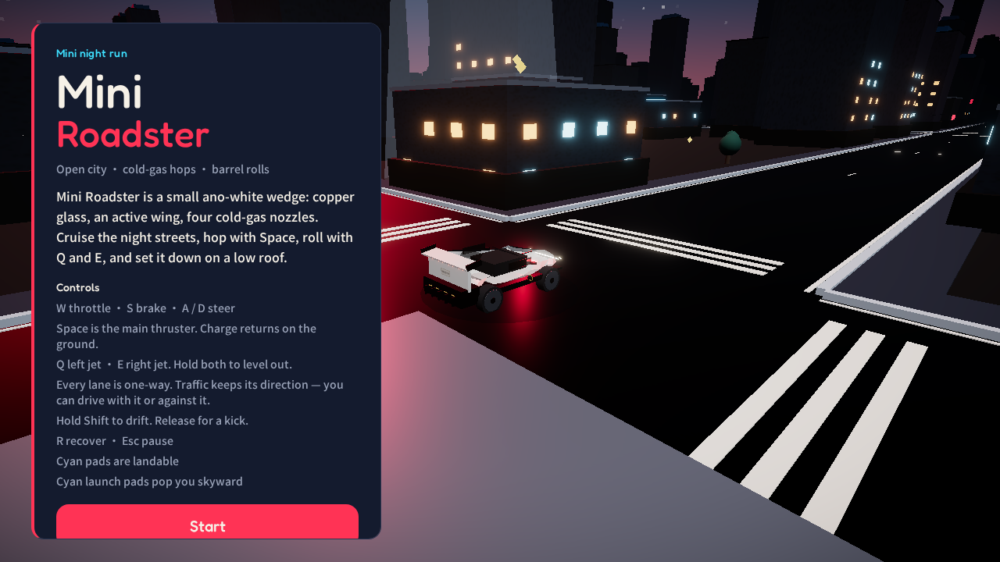
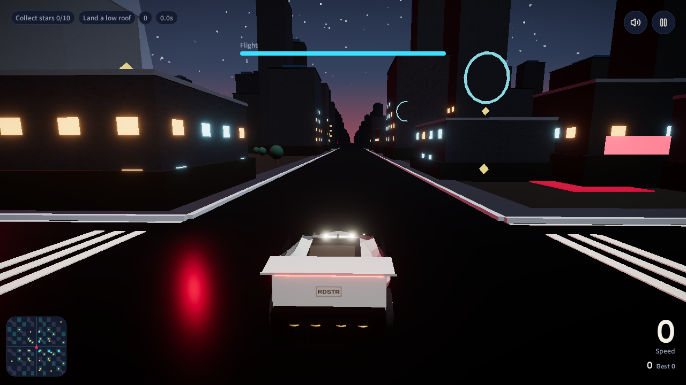
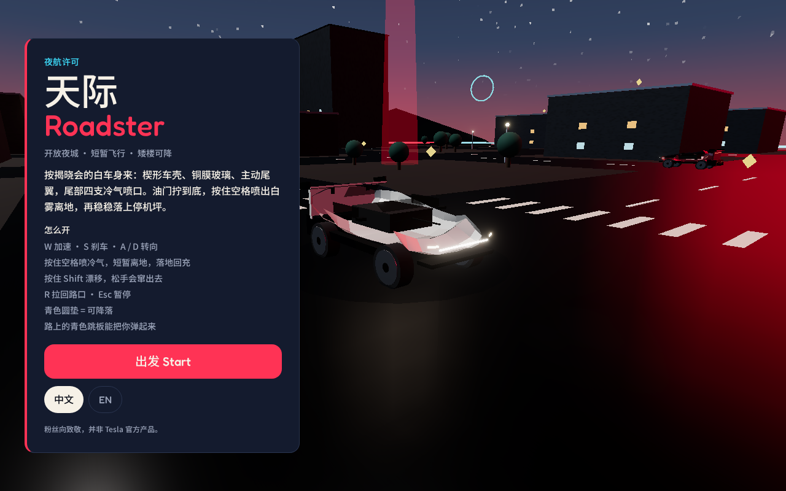
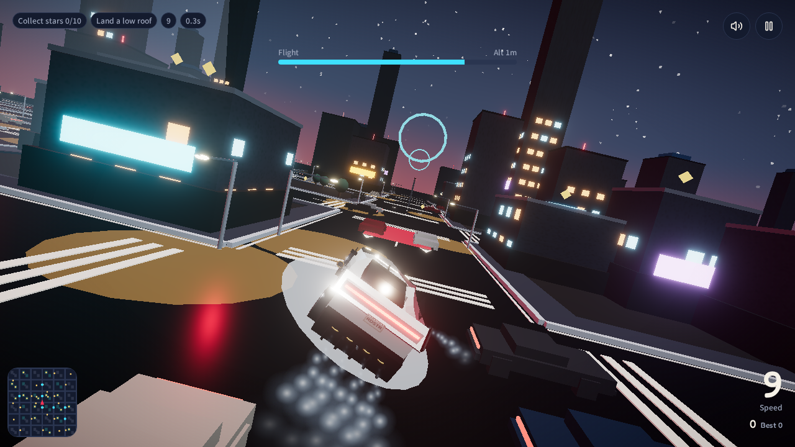

# Mini Roadster

[English](#english) · [中文](#中文)

A browser night-city racer built around a small white wedge car. Cruise one-way avenues, hop with cold-gas thrusters, roll in the air, and set down on low roofs.

一款跑在浏览器里的夜间城市驾驶游戏。白楔形小车沿着单行大道开，冷气喷口可以短暂离地、空中翻滚，矮楼顶可以降落。

> Fan tribute. Not a Tesla product.  
> 粉丝向致敬，并非 Tesla 官方产品。

---

<a id="english"></a>

## English

### Background

Mini Roadster started as a small open-city driving toy and grew into a night arcade drive. The car is an ano-white wedge with copper glass, an active wing, and four cold-gas nozzles. The city is one static map: long avenues, buildings between crossings, other cars that keep their lane direction, stars, rings, and cyan pads.

You can drive with traffic or against it. Traffic does not spawn on top of you at the start. Low roofs accept a landing. Tall crowns push you off. Flight energy refills on the ground.

The interface follows the browser language (`zh` or `en`) until you pick one. The choice is stored as `mini-roadster-lang`.

### Screenshots

Title screen. The copy matches the browser language.



A night avenue after Start. Roads are one-way, with a long gap between crossings.



The car, close in. White body, copper glass, active wing.



Left jet rolls the car. Hold Q and E together to level out.



### How to play

| Action | Keyboard | Touch |
| --- | --- | --- |
| Throttle / brake | W / S | on-screen drive |
| Steer | A / D | steer |
| Main jet | Space | 主喷 / Main |
| Roll left / right | Q / E | 左喷 / 右喷 |
| Level out | Q + E together | both roll buttons |
| Drift | hold Shift | Drift |
| Recover to the junction | R | Recover |
| Pause | Esc | Pause |

Tonight's goals: collect stars, land a low roof, reach 180 km/h, stay airborne for 4 seconds. Best score stays in local storage.

### Current environment

Checked 2026-10-19. The dev server was up and answered HTTP 200.

| | |
| --- | --- |
| OS | Linux |
| Node.js | 22.23.3 |
| npm | 10.9.9 |
| React | 19.3.0 |
| TanStack Start | 1.168.60 |
| Three.js | 0.186.1 |
| Bind | `0.0.0.0:8080` |
| City | about 2.9 km across, 1.4 km from center to the edge |
| Crossings | every 128 m |
| Traffic | 50 cars, one direction per street |

### Access

Current URL:

**https://mini-roadster.grok.me/**

Open that URL. The in-app live preview is the same build. Language starts from `navigator.languages`. The process on this machine still listens on `0.0.0.0:8080`; the public address above is what you actually open.

### Run

```bash
npm install
npm run dev
```

Other checks:

```bash
npm run typecheck
node --experimental-strip-types --test src/game/sim.test.ts
npm run build
```

`npm run dev` is Vite on port 8080. `npm run build` writes the production bundle. `npm run preview:restart` serves that bundle on port 8081.

### Layout

```text
src/game/        driving, city, car, copy
src/routes/      the page that mounts the game
screenshots/     images used above
```

Physics is a fixed step in `src/game/sim.ts`. The city is generated once in `src/game/world.ts` (`CITY_R = 45`). Buildings are drawn in distance chunks so the large map does not upload as a single mesh.

---

<a id="中文"></a>

## 中文

### 项目背景

Mini Roadster 起初是一个开放城市的小驾驶玩具，后来做成夜间街机驾驶。车是哑白楔形车身，铜膜玻璃、主动尾翼、车尾四支冷气喷口。城市一次生成，不再边开边刷区块：大道拉得很长，路口之间是楼，其他车按车道方向走，路上有星星、光环和青色跳板。

你可以顺行，也可以逆行。开局附近没有车对着你冲过来。矮楼可以降落，高楼顶会把车推下去。飞行能量落地后回充。

界面先按浏览器语言选中文或英文。你手动切换之后，选择记在 `mini-roadster-lang`。

### 截图

标题画面。文案跟浏览器语言走。


点「出发」之后的夜路。车道单行，路口之间隔得比较开。


车身近景。白车壳、铜膜玻璃、主动尾翼。


左喷气会让车翻滚。Q 和 E 一起按住会回正。


### 怎么开

| 动作 | 键盘 | 触控 |
| --- | --- | --- |
| 加速 / 刹车 | W / S | 屏幕驾驶键 |
| 转向 | A / D | 转向 |
| 主喷气 | 空格 | 主喷 |
| 左喷 / 右喷 | Q / E | 左喷 / 右喷 |
| 回正 | 同时按住 Q 和 E | 两个翻滚键一起按 |
| 漂移 | 按住 Shift | 漂移 |
| 拉回路口 | R | 拉回 |
| 暂停 | Esc | 暂停 |

今夜目标：收集星星、降落矮楼、时速 180、滞空 4 秒。最高分存在本地。

### 当前运行环境

核对时间 2026-10-19。开发服务器当时在运行，首页返回 HTTP 200。

| | |
| --- | --- |
| 系统 | Linux |
| Node.js | 22.23.3 |
| npm | 10.9.9 |
| React | 19.3.0 |
| TanStack Start | 1.168.60 |
| Three.js | 0.186.1 |
| 监听 | `0.0.0.0:8080` |
| 地图 | 大约 2.9 公里宽，市中心到边缘约 1.4 公里 |
| 路口间距 | 128 米 |
| 交通 | 50 辆，每条街一个方向 |

### 当前访问地址

**https://mini-roadster.grok.me/**

在浏览器里打开这个地址即可。应用里的实时预览也是同一套页面。语言默认跟 `navigator.languages`。本机进程仍监听 `0.0.0.0:8080`，上面这个地址才是实际访问入口。

### 本地运行

```bash
npm install
npm run dev
```

其他检查：

```bash
npm run typecheck
node --experimental-strip-types --test src/game/sim.test.ts
npm run build
```

`npm run dev` 用 Vite 起在 8080。`npm run build` 打生产包。`npm run preview:restart` 把生产包开在 8081。

### 目录

```text
src/game/        驾驶、城市、车、文案
src/routes/      挂上游戏的页面
screenshots/     上面用到的图
```

物理在 `src/game/sim.ts` 里按固定步长走。城市在 `src/game/world.ts` 里一次生成（`CITY_R = 45`）。楼按距离分块绘制，避免整张大地图合成一个网格。
